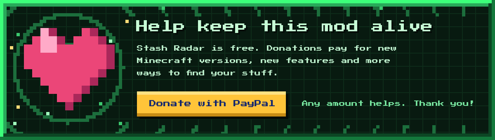

**Stop opening every chest. Just ask the radar.**

You know the diamonds are *somewhere*. Twenty chests, three barrels and a wall of shulker boxes later, you still haven't found them. **Stash Radar finds them for you.** Type the item, and every nearby container that has it lights up.

---

🧩 **Works with modded containers too.** Add any modded chest or crate to the config and it gets searched like a vanilla one.

## 🔥 What it does

### 📡 Search screen
Press **K**, start typing, pick the item from the list (with icons). Enter picks the first match. Choose how far to search with the **Range** button.

### ✨ Outlines only you can see
Every container that has the item gets a glowing particle outline for a few seconds. Other players don't see your search.

### 🧭 "Nearest: 6 blocks north-east"
A chat line tells you how many you have, in how many containers, and which way the nearest one is.

### 📦 Looks inside shulker boxes
Shulker boxes **and** shulker box items stored in chests count too (plus bundles).

### 🛡️ Checked by the server
The server reads what's really inside the containers. Your game never sends a list of chest contents, so Stash Radar can't be used to peek or cheat, and results are always up to date. No need to open every chest once first like client-side finders.

### 🌍 Players without the mod can use it too
On a server with Stash Radar, anyone can type `/find diamond`, even with a vanilla client. Tab-complete suggests item names.

### ⚙️ You decide the rules
Range, max range, cooldown, who can use it, which containers are searched, highlight time and color: all in `config/stashradar.json`. It only searches chunks that are already loaded, so it never slows the server down by loading the world.

## 🎮 Controls
| Key / command | What it does |
|---|---|
| **K** | Open the search screen |
| `/find <item> [range]` | Search from chat (everyone, vanilla clients too) |
| `/stashradar reload` | Reload the config (operators) |

Change the key in Options → Controls → Key Binds.

## 📦 Requirements
- **Forge:** Minecraft 1.21.1
- **NeoForge:** Minecraft 1.21.1
- More versions are added as soon as they pass testing.
- **Running a Paper server?** Get **Stash Radar Plugin** here: https://www.curseforge.com/minecraft/bukkit-plugins/stash-radar
- **Requires LogicLib** (shared code for my mods)
- Install on the **server** for searching. Install on the **client** too for the search screen (K). Singleplayer: just install it.
- Pick the file for your Minecraft version and loader on the Files tab.

Source and bug reports: https://github.com/CosmicLogic0/stashradar

---

## ❤️ Support the mod

Stash Radar is free. Donations keep the mod up to date with fixes, new Minecraft versions and new features. [Donate with PayPal](https://www.paypal.com/paypalme/DylanEMason) - any amount helps. Thank you!

---

## 🎮 Play on the creator's server
**Logic Survival** (`play.logicsurvival.fyi`) is the survival server run by the maker of this mod. **Heads up:** this mod adds Logic Survival to the **end** of your Multiplayer server list **one time only**. If you delete it, it won't come back, not from this mod and not from any of my other mods. Don't want it at all? Set `addCreatorServer = false` in the config. Modpack makers can turn it off the same way.
