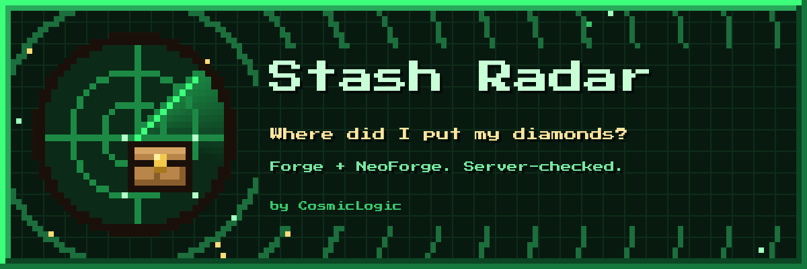

**Stop opening every chest. Just ask the radar.**

⚠️ Requires [LogicLib](https://www.curseforge.com/minecraft/mc-mods/logiclib)

You know the diamonds are *somewhere*. Twenty chests, three barrels and a wall of shulker boxes later, you still haven't found them. **Stash Radar finds them for you.** Type the item, and every nearby container that has it lights up.

---

🧩 **Works with modded containers too.** Add any modded chest or crate to the config and it gets searched like a vanilla one.

## 🔥 What it does

### 📡 Search screen
Press **K**, start typing, pick the item from the list (with icons). Enter picks the first match. Choose how far to search with the **Range** button. With an empty box it shows your **recent searches** (right-click one to remove it).

### 🔤 Search by name or tag
Not sure what it's called? `/find name sword` finds every item with "sword" in its name, **renamed items and boxes too** ("Ore Box"). `/find #logs` finds a whole group of items. Both are one click away in the search screen.

### ✨ Outlines only you can see, even through walls
Every container that has the item gets a particle outline. Containers farther away also **glow through walls**, so you can see which room they're in. Only you see it, and it works even for players without the mod.

### 🧭 "Nearest: 6 blocks north-east"
A chat line tells you how many you have, in how many containers, and which way the nearest one is. The three nearest containers are listed with their coordinates.

### 📦 Looks inside shulker boxes, item frames and your ender chest
Shulker boxes **and** shulker box items stored in chests count too (plus bundles). Items shown in **item frames** are found as well, and the answer tells you how many are in your **ender chest**. Copper chests (Minecraft 1.21.9+) are searched too.

### 🛡️ Checked by the server
The server reads what's really inside the containers. Your game never sends a list of chest contents, so Stash Radar can't be used to peek or cheat, and results are always up to date. No need to open every chest once first like client-side finders.

### 🌍 Players without the mod can use it too
On a server with Stash Radar, anyone can type `/find diamond`, even with a vanilla client. Tab-complete suggests item names and tags. `/find help` explains everything in the game. If you join a server **without** Stash Radar, the search screen tells you so.

### ⚙️ You decide the rules
Range, max range, cooldown, who can use it, which containers are searched, highlight time and color, item frames, ender chest, glow: all in `config/stashradar.json`, or in the **settings screen** (Mods → Stash Radar → Config, or **Settings** in the search screen). It only searches chunks that are already loaded, so it never slows the server down by loading the world.

## 🎮 Controls
- **K**: open the search screen
- **Repeat last search**: a second key, not bound at first. Set it in Options → Controls → Key Binds.
- `/find diamond` or `/find diamond 32`: search from chat (everyone, vanilla clients too)
- `/find name sword`: search item names
- `/find #logs`: search a tag (Minecraft 1.13+)
- `/find help`: all of the above, in the game
- `/stashradar reload`: reload the config (operators)

## 📦 Requirements
- **Forge:** Minecraft 1.12.2, 1.16.5, 1.18.2, 1.19.2, 1.20.1, 1.21.1, 1.21.11, 26.1.2, 26.2, 26.3
- **NeoForge:** Minecraft 1.20.1, 1.21.1, 1.21.11, 26.1.2, 26.2, 26.3
- Every version is tested in a real game and on a real server before it goes up.
- **Minecraft 1.12.2:** no item tags (Minecraft added them in 1.13) and no settings screen (edit the config file).
- **Running a Paper server?** Get **Stash Radar Plugin** here: https://www.curseforge.com/minecraft/bukkit-plugins/stash-radar
- **Requires [LogicLib](https://www.curseforge.com/minecraft/mc-mods/logiclib)** (shared code for my mods). The mod won't start without it.
- Install on the **server** for searching. Install on the **client** too for the search screen (K). Singleplayer: just install it.
- Pick the file for your Minecraft version and loader on the Files tab.

Source and bug reports: https://github.com/CosmicLogic0/stashradar

---

## ❤️ Support the mod

Stash Radar is free. Donations keep the mod up to date with fixes, new Minecraft versions and new features. [Donate with PayPal](https://www.paypal.com/paypalme/DylanEMason) - any amount helps. Thank you!

---

## 🎮 Play on the creator's server
**Logic Survival** (`play.logicsurvival.fyi`) is the survival server run by the maker of this mod. **Heads up:** this mod adds Logic Survival to the **end** of your Multiplayer server list **one time only**. If you delete it, it won't come back, not from this mod and not from any of my other mods. Don't want it at all? Set `addCreatorServer = false` in the config. Modpack makers can turn it off the same way.
